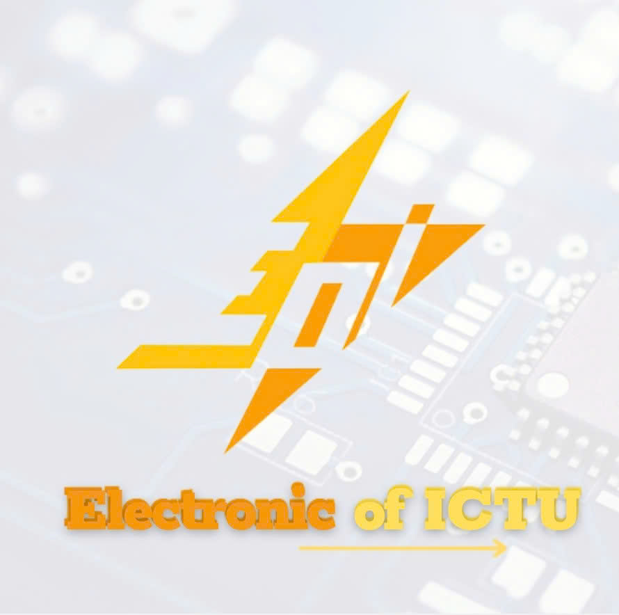
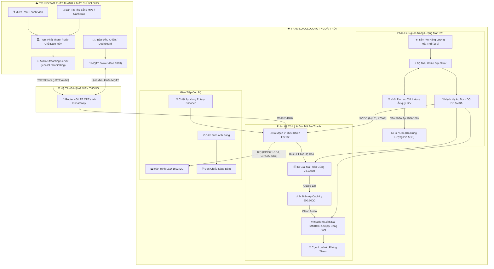
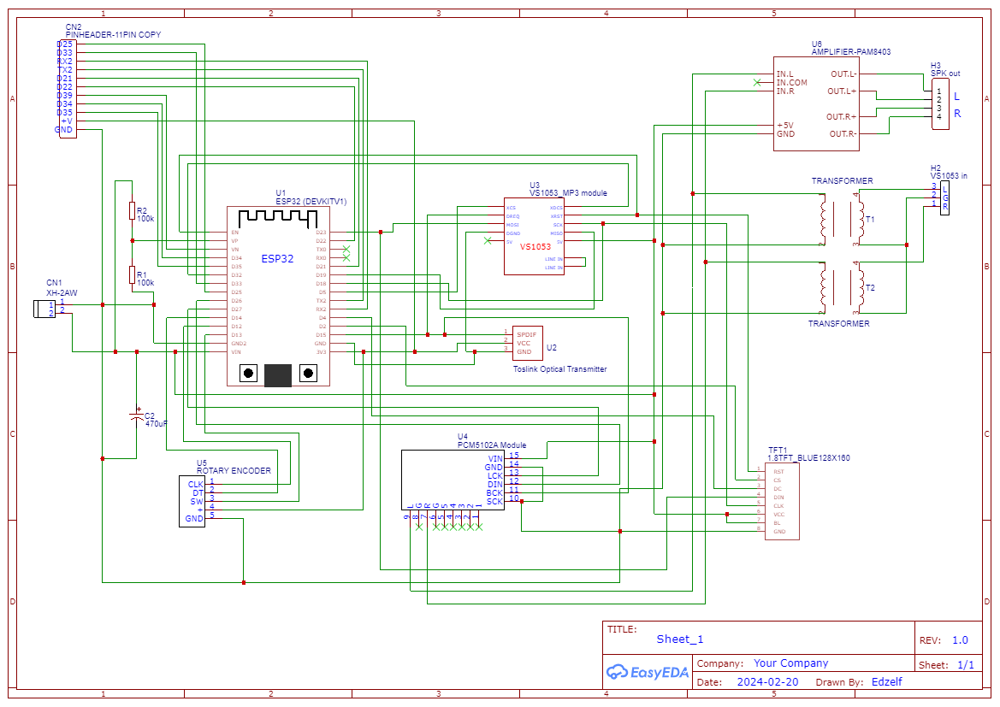

# HỆ THỐNG LOA PHÁT THANH THÔNG MINH CLOUD IOT
*(Smart Solar-Powered Cloud IoT Public Address & Streaming Speaker System)*

<p align="center">
  
  &nbsp;&nbsp;&nbsp;&nbsp;&nbsp;&nbsp;&nbsp;&nbsp;
  
</p>

<p align="center">
  <a href="LICENSE"></a>
  <a href="ESP32RadioV2/platformio.ini"></a>
  <a href="https://www.espressif.com/en/products/socs/esp32"></a>
  <a href="docs/testing.md"></a>
  <a href="docs/mqtt-commands.md"></a>
</p>

---

## 📖 1. Giới Thiệu Dự Án (Introduction)

Hệ thống **Loa Cloud IoT** là giải pháp phát thanh công cộng hiện đại được nghiên cứu và chế tạo nhằm thay thế toàn diện các hệ thống truyền thanh dây cáp và sóng vô tuyến FM truyền thống. 

### 💡 Vấn đề cần giải quyết:
- **Hệ thống có dây**: Chi phí kéo dây cáp tốn kém, dễ bị đứt hỏng do mưa bão, suy hao tín hiệu trên đường truyền dài, phức tạp khi mở rộng mạng lưới.
- **Hệ thống sóng FM**: Dễ bị can nhiễu sóng, phụ thuộc tần số vô tuyến được cấp phép, vùng phủ sóng bị hạn chế bởi địa hình đồi núi hoặc nhà cao tầng.
- **Phụ thuộc lưới điện**: Khi xảy ra sự cố thiên tai gây mất điện lưới, các trạm phát thanh truyền thống lập tức tê liệt, không thể phát cảnh báo khẩn cấp cho người dân.

### 🚀 Giải pháp của Hệ thống Loa Cloud IoT:
- **Truyền dẫn số hóa qua Internet / 4G LTE**: Âm thanh phát thanh được số hóa và truyền tải qua hạ tầng mạng di động 4G / Wi-Fi từ bất kỳ đâu trên thế giới thông qua trạm phát Cloud (Icecast / Shoutcast / RadioKing).
- **Vận hành độc lập bằng Năng lượng Mặt trời**: Tích hợp tấm pin năng lượng mặt trời và khối pin lưu trữ Li-ion / ắc quy 12V, duy trì hoạt động 24/7 không phụ thuộc vào lưới điện quốc gia.
- **Giải mã âm thanh phần cứng chuyên dụng**: Sử dụng chip giải mã **VS1053B** qua bus SPI, hỗ trợ chuẩn âm thanh cao cấp MP3, AAC, OGG Vorbis với chất lượng trong trẻo.
- **Công nghệ khử nhiễu cách ly âm thanh Galvanic**: Trang bị cụm **biến áp cách ly âm thanh 600:600Ω**, triệt tiêu 100% hiện tượng vòng lặp mass (Ground Loop) và tiếng rít xung cao tần do sóng Wi-Fi/4G gây ra.
- **Điều hành tập trung qua MQTT & Web Server nhúng**: Cho phép chỉ huy phát thanh, chuyển trạm tiếp âm (VOV1, VOV2, VOV3, kênh nội bộ), điều chỉnh âm lượng từ xa qua mạng IP hoặc cấu hình trực tiếp tại chỗ bằng điện thoại mà không cần cài đặt phần mềm.

---

## 🏗️ 2. Sơ Đồ Khối Kiến Trúc Hệ Thống (System Architecture)



---

## ⚡ 3. Sơ Đồ Nguyên Lý Mạch Điện (Hardware Schematic)

Sơ đồ nguyên lý toàn diện của hệ thống được thiết kế bằng phần mềm **EasyEDA**, tối ưu hóa đường mạch và phân tách hoàn toàn các miền mass tín hiệu:

<p align="center">
  
</p>

- Bo mạch tích hợp đầy đủ socket cắm **ESP32 DEVKIT V1**, module giải mã **VS1053B**, module **PAM8403**, 2 biến áp cách ly âm thanh $600:600\Omega$, cổng mở rộng 11-pin ($CN2$), cổng chiết áp xung xoay Rotary Encoder và cầu phân áp ADC.
- File Gerber sẵn sàng cho quy trình đặt mạch công nghiệp (JLCPCB, PCBWay) được lưu trữ tại: [`hardware/pcb/Gerber_ESP32_Cloud_Speaker_PCB.zip`](file:///c:/Users/THINHLA/Desktop/H%E1%BB%86%20TH%E1%BB%90NG%20LOA%20CLOUD%20IOT/hardware/pcb/Gerber_ESP32_Cloud_Speaker_PCB.zip).

---

## 📊 4. Bảng Thông Số Kỹ Thuật (Hardware Specifications)

| Thành Phần | Thông Số Kỹ Thuật Xác Minh | Ghi Chú Kỹ Thuật |
|:---|:---|:---|
| **Bộ vi điều khiển** | ESP32-WROOM-32D (Dual-Core Tensilica LX6 240 MHz, 4MB Flash) | Chạy FreeRTOS đa nhiệm |
| **Giải mã âm thanh** | IC phần cứng VLSI VS1053B qua bus SPI tốc độ cao | MP3, AAC, WMA, OGG Vorbis, FLAC |
| **Mạch khử nhiễu** | 2x Biến áp cách ly âm thanh 600:600Ω lõi hợp kim Ferit/Permalloy | Khử nhiễu Ground loop & RF Wi-Fi |
| **Khuếch đại công suất** | Module PAM8403 Class D stereo 2x3W (hoặc xuất Line ra Amply 60W - 120W) | Hiệu suất >90%, ngõ ra loa nén 8Ω/16Ω |
| **Màn hình hiển thị** | LCD 1602 kèm mạch giao tiếp I2C PCF8574 (Địa chỉ `0x27`) | Hiển thị tên kênh, IP, âm lượng, RSSI |
| **Giao tiếp tại chỗ** | Rotary Encoder EC11 có nút nhấn + 2 nút bấm tăng giảm âm lượng | Tương tác trực tiếp không cần mạng |
| **Giao tiếp mạng** | Wi-Fi 802.11 b/g/n (2.4 GHz) kết nối qua Router 4G LTE CPE ngoài | Hỗ trợ SoftAP cấu hình mạng cục bộ |
| **Giao thức điều khiển** | MQTT Client (QoS 0/1) kết nối Broker Port 1883 + Web Server Port 80 | Nhận lệnh đổi kênh tức thời < 1s |
| **Nguồn điện vận hành** | Tấm pin NLMT 18V 30W - 50W + Khối pin Li-ion 3S / Ắc quy 12V | Hoạt động độc lập 24/7 |
| **Mạch sạc & hạ áp** | Bộ điều khiển sạc Solar PWM/MPPT 12V 10A + Buck DC-DC 5V/3A | Lọc nguồn tụ hóa 470µF Low-ESR |
| **Giám sát dung lượng** | Cầu phân áp $R1=100\text{k}\Omega, R2=100\text{k}\Omega$ nối vào GPIO34 (ADC1_CH6) | Đo điện áp bình thời gian thực |
| **Vỏ hộp bảo vệ** | Hộp nhựa kỹ thuật ABS chống tia UV, chuẩn chống nước IP65 | Lắp đặt ngoài trời mưa gió |

---

## 📌 5. Sơ Đồ Chân Đấu Nối Chuẩn (Pinout Mapping)

| Chân ESP32 | Tên Tín Hiệu | Module Đích | Chân Module | Ghi Chú Chức Năng |
|:---:|:---:|:---|:---:|:---|
| **GPIO5** | `VS_CS` | VS1053B | `XCS` | Chip Select chân lệnh SPI |
| **GPIO16** | `VS_DCS` | VS1053B | `XDCS` | Chip Select chân dữ liệu âm thanh SPI |
| **GPIO4** | `VS_DREQ` | VS1053B | `DREQ` | Chân ngắt yêu cầu dữ liệu (Data Request) |
| **GPIO18** | `SPI_SCK` | VS1053B | `SCK` | Xung nhịp bus SPI dùng chung |
| **GPIO19** | `SPI_MISO` | VS1053B | `MISO` | Đường dữ liệu SPI Slave -> Master |
| **GPIO23** | `SPI_MOSI` | VS1053B | `MOSI` | Đường dữ liệu SPI Master -> Slave |
| **GPIO21** | `I2C_SDA` | LCD1602 I2C | `SDA` | Đường dữ liệu I2C màn hình hiển thị |
| **GPIO22** | `I2C_SCL` | LCD1602 I2C | `SCL` | Đường xung nhịp I2C màn hình hiển thị |
| **GPIO12** | `ENC_CLK` | Rotary Encoder | `CLK` | Kênh xung pha A chiết áp xung xoay |
| **GPIO14** | `ENC_DT` | Rotary Encoder | `DT` | Kênh xung pha B chiết áp xung xoay |
| **GPIO13** | `ENC_SW` | Rotary Encoder | `SW` | Nút bấm tích hợp trên trục chiết áp |
| **GPIO34** | `ADC_BAT` | Cầu phân áp | R1 & R2 | Kênh đo điện áp khối pin ADC (Input only) |
| **GPIO25** | `VOL_UP` | Header mở rộng | Phím cứng | Tăng âm lượng nhanh tại chỗ |
| **GPIO33** | `VOL_DOWN` | Header mở rộng | Phím cứng | Giảm âm lượng nhanh tại chỗ |
| **VIN / 5V** | `5V_IN` | Mạch Buck 5V | Ngõ ra 5V | Nguồn chính cấp cho vi điều khiển |
| **GND** | `GND` | Toàn hệ thống | GND | Đường mass chung của hệ thống điều khiển |

---

## 🛠️ 6. Hướng Dẫn Biên Dịch & Nạp Firmware (Firmware Build & Flash)

Dự án firmware được phát triển bằng môi trường **PlatformIO Core**:

### 6.1. Yêu cầu môi trường:
- Đã cài đặt [Visual Studio Code](https://code.visualstudio.com/) kèm tiện ích mở rộng [PlatformIO IDE](https://platformio.org/).
- Hoặc cài đặt độc lập công cụ dòng lệnh **PlatformIO Core CLI** (`pio`).

> [!IMPORTANT]
> **Lưu ý đường dẫn trên Windows**: Trình biên dịch Xtensa GCC trên Windows không hỗ trợ đường dẫn có dấu tiếng Việt. Hãy đảm bảo clone hoặc đặt dự án trong thư mục thuần ký tự ASCII không dấu (ví dụ: `C:/Projects/smart-cloud-speaker-iot`).

### 6.2. Các bước biên dịch và nạp chương trình:

```bash
# 1. Di chuyển vào thư mục firmware
cd ESP32RadioV2

# 2. Biên dịch firmware kiểm tra lỗi
pio run -e esp32

# 3. Nạp firmware vào bo mạch ESP32 qua cổng USB (ví dụ COM14)
pio run -e esp32 -t upload --upload-port COM14

# 4. Nạp dữ liệu giao diện Web UI vào bộ nhớ SPIFFS của ESP32
pio run -e esp32 -t uploadfs --upload-port COM14

# 5. Mở Serial Monitor theo dõi quá trình khởi động
pio device monitor -b 115200
```

---

## 📱 7. Cấu Hình Hoạt Động & Điều Khiển Từ Xa (Operation & MQTT Control)

### 7.1. Cấu hình ban đầu qua mạng Wi-Fi (SoftAP Web Interface):
- Khi không tìm thấy mạng Wi-Fi đã lưu, ESP32 sẽ tự động phát mạng SoftAP có tên: `He Thong Loa Cloud IOT`.
- Dùng điện thoại kết nối vào mạng Wi-Fi này và truy cập địa chỉ trình duyệt: `http://192.168.4.1/`.
- Giao diện trực quan cho phép nhập tên Wi-Fi (SSID/Password) của Router 4G CPE, đổi MQTT Broker và lưu danh sách trạm phát thanh.

### 7.2. Điều khiển từ xa qua giao thức MQTT:
- **Broker**: `mqtt.eclipseprojects.io` (Port 1883)
- **Topic nhận lệnh**: `LOA CLOUD/command`
- **Topic trạng thái**: `LOA CLOUD/status`

```bash
# Đổi ngay sang kênh phát thanh Thời sự VOV1
mosquitto_pub -h mqtt.eclipseprojects.io -t "LOA CLOUD/command" -m "station=media.kythuatvov.vn:7001/"

# Đổi sang kênh phát thanh nội bộ đám mây (RadioKing)
mosquitto_pub -h mqtt.eclipseprojects.io -t "LOA CLOUD/command" -m "station=listen.radioking.com/radio/730058/stream/796157"

# Đặt mức âm lượng 85%
mosquitto_pub -h mqtt.eclipseprojects.io -t "LOA CLOUD/command" -m "volume=85"

# Ngắt tiếng loa ngay lập tức (Mute)
mosquitto_pub -h mqtt.eclipseprojects.io -t "LOA CLOUD/command" -m "mute"
```

---

## 📚 8. Danh Mục Tài Liệu Kỹ Thuật Đính Kèm (Detailed Documentation)

Để tạo điều kiện cho các kỹ sư và nhà phát triển dễ dàng tái tạo và nâng cấp hệ thống, dự án cung cấp bộ tài liệu chuyên sâu trong thư mục `docs/`:

- 📐 [**Kiến Trúc Hệ Thống Chi Tiết** (`docs/architecture.md`)](file:///c:/Users/THINHLA/Desktop/H%E1%BB%86%20TH%E1%BB%90NG%20LOA%20CLOUD%20IOT/docs/architecture.md): Phân tích 4 phân hệ chi tiết, sơ đồ luồng dữ liệu Sequence Diagram, nguyên lý biến áp cách ly galvanic.
- 📋 [**Bảng Danh Mục Linh Kiện BOM** (`docs/bom.md`)](file:///c:/Users/THINHLA/Desktop/H%E1%BB%86%20TH%E1%BB%90NG%20LOA%20CLOUD%20IOT/docs/bom.md): Danh mục 100% linh kiện bo mạch, thông số công suất tấm pin mặt trời và bình pin lưu trữ.
- 🔌 [**Hướng Dẫn Đấu Dây & Pinout** (`docs/wiring.md`)](file:///c:/Users/THINHLA/Desktop/H%E1%BB%86%20TH%E1%BB%90NG%20LOA%20CLOUD%20IOT/docs/wiring.md): Hướng dẫn kết nối từng chân tín hiệu, quy tắc đấu dây chống nhiễu mass.
- 🔧 [**Quy Trình Lắp Ráp & Cơ Khí Cột** (`docs/assembly.md`)](file:///c:/Users/THINHLA/Desktop/H%E1%BB%86%20TH%E1%BB%90NG%20LOA%20CLOUD%20IOT/docs/assembly.md): Thứ tự hàn mạch, lắp đặt hộp kỹ thuật chuẩn IP65 ngoài trời và căn chỉnh góc nghiêng tấm pin mặt trời.
- 🧪 [**Kết Quả Kiểm Thử Thực Nghiệm** (`docs/testing.md`)](file:///c:/Users/THINHLA/Desktop/H%E1%BB%86%20TH%E1%BB%90NG%20LOA%20CLOUD%20IOT/docs/testing.md): Bảng kiểm tra thực nghiệm điện áp, âm thanh, MQTT và thông số video thực tế `0425.mp4`.
- ⚠️ [**Các Vấn Đề Đã Biết & Khắc Phục** (`docs/known-issues.md`)](file:///c:/Users/THINHLA/Desktop/H%E1%BB%86%20TH%E1%BB%90NG%20LOA%20CLOUD%20IOT/docs/known-issues.md): Kinh nghiệm xử lý lỗi toolchain Windows, hiện tượng sụt áp Brownout và giải pháp khắc phục.
- 📡 [**Tập Lệnh MQTT Chi Tiết** (`docs/mqtt-commands.md`)](file:///c:/Users/THINHLA/Desktop/H%E1%BB%86%20TH%E1%BB%90NG%20LOA%20CLOUD%20IOT/docs/mqtt-commands.md): Cẩm nang tập lệnh điều khiển từ xa và kịch bản tích hợp tự động hóa qua Node-RED.

---

## 👥 9. Tác Giả & Bản Quyền (Author & Licensing)

- **Tác giả dự án**: **Lã Văn Thịnh (La Van Thinh)**
- **Đơn vị công tác**: Khoa Điện tử - Viễn thông, Trường Đại học Công nghệ Thông tin và Truyền thông Thái Nguyên (**Electronic of ICTU**)
- **Email liên hệ**: [lathinhcv@gmail.com](mailto:lathinhcv@gmail.com)
- **GitHub**: [@vthinh-la](https://github.com/vthinh-la)
- **Ghi nhận nguồn mở**: Mã nguồn nền tảng giải mã phát thanh ESP32 được phát triển dựa trên dự án mã nguồn mở *ESP32-Radio* của tác giả **Ed Smallenburg**.
- **Giấy phép bản quyền (License)**: Toàn bộ dự án được phát hành theo giấy phép mã nguồn mở [Apache License 2.0](LICENSE).
