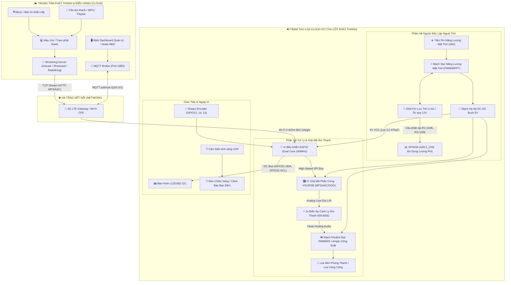
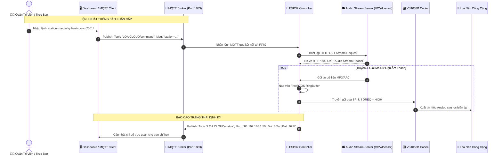

# KIẾN TRÚC HỆ THỐNG LOA PHÁT THANH THÔNG MINH CLOUD IOT
*(Smart Cloud IoT PA Speaker System Architecture)*

## 1. Tổng Quan Kiến Trúc (Architecture Overview)

Hệ thống **Loa Cloud IoT** là giải pháp phát thanh công cộng thế hệ mới, thay thế toàn diện các hệ thống phát thanh truyền thống (FM vô tuyến hoặc truyền thanh có dây kéo dài). Hệ thống hoạt động hoàn toàn độc lập dựa trên hạ tầng mạng viễn thông không dây (4G LTE / Wi-Fi) và nguồn năng lượng tái tạo (Pin năng lượng mặt trời kết hợp lưu trữ ắc quy/Li-ion).

---

## 2. Phân Hệ Chi Tiết (Subsystems Breakdown)

### 2.1. Phân Hệ Xử Lý Trung Tâm & Giải Mã Âm Thanh (Core & Codec)

- **Vi điều khiển ESP32-WROOM-32D**:
  - Vi xử lý lõi kép Tensilica Xtensa 32-bit LX6, xung nhịp 240 MHz.
  - Tích hợp kết nối Wi-Fi 802.11 b/g/n (2.4 GHz) và Bluetooth v4.2 BR/EDR & BLE.
  - Chạy hệ điều hành thời gian thực FreeRTOS: phân chia luồng nhận stream mạng (Network Task) và luồng đẩy dữ liệu vào bộ giải mã (Play Task) độc lập để ngăn chặn hiện tượng nghẽn bộ đệm.
- **Module Giải Mã Phần Cứng VS1053B**:
  - Giao tiếp với ESP32 thông qua chuẩn SPI tốc độ cao.
  - Giải mã phần cứng hoàn toàn cho các định dạng: MP3, AAC, WMA, OGG Vorbis, FLAC, WAV, MIDI.
  - Tích hợp bộ giải mã DAC 18-bit với độ méo hài tổng THD cực thấp (< 0.1%).
  - Chân tín hiệu điều khiển:
    - `VS_CS` (Chip Select) -> **GPIO5**
    - `VS_DCS` (Data Chip Select) -> **GPIO16** (hoặc GPIO32 trên bản mở rộng)
    - `VS_DREQ` (Data Request Interrupt) -> **GPIO4**
    - Bus SPI dùng chung: `SCK` (**GPIO18**), `MISO` (**GPIO19**), `MOSI` (**GPIO23**).

### 2.2. Phân Hệ Khử Nhiễu & Khuếch Đại Âm Thanh (Noise Isolation & PA)

Trong các thiết bị IoT tích hợp Wi-Fi/4G và bộ khuếch đại Class-D trên cùng một mạch nguồn, hiện tượng **nhiễu vòng lặp mass (Ground Loop)** và **nhiễu RF xung cao tần từ anten** thường tạo ra tiếng rít khó chịu ở loa.

- **2x Biến áp âm thanh cách ly 600:600Ω (T1, T2)**: Cách ly hoàn toàn đường mass tín hiệu âm thanh của module VS1053 khỏi đường mass công suất của PAM8403, triệt tiêu 100% tiếng ù xì tần số 50/100Hz và tiếng lách tách do phát xạ Wi-Fi.
- **Mạch khuếch đại PAM8403**:
  - Mạch công suất Class D hiệu suất cao (> 90%), hạn chế sinh nhiệt.
  - Công suất stereo 2 x 3W @ 4Ω (dùng phát thử nghiệm hoặc kiểm âm nội bộ).
  - Có thể đưa tín hiệu từ sau biến áp cách ly ra cổng Jack 3.5mm / Terminal để truyền vào Amply truyền thanh công suất lớn (60W - 120W - 250W) để kéo dàn loa nén ngoài trời.

### 2.3. Phân Hệ Nguồn Điện Năng Lượng Mặt Trời (Solar Power Subsystem)

- **Nguyên lý hoạt động**:
  - Tấm pin mặt trời hấp thụ quang năng và tạo điện áp 18V nạp cho pin lưu trữ thông qua mạch sạc năng lượng mặt trời chuyên dụng.
  - Mạch hạ áp Buck DC-DC hiệu suất cao chuyển đổi điện áp bình về chuẩn ổn định 5.0V / 3A cung cấp cho hệ thống vi mạch.
  - Tụ hóa lọc nguồn dung lượng lớn **C2 (470µF / 16V)** đặt sát chân nguồn vào nhằm hấp thụ xung dòng tức thời khi module Wi-Fi phát công suất đỉnh (Peak Current lên tới ~500mA).
- **Giám Sát Điện Áp Nguồn Bằng Cầu Phân Áp ADC**:
  - Cầu phân áp gồm 2 điện trở $R1 = 100\text{ k}\Omega$ và $R2 = 100\text{ k}\Omega$ mắc nối tiếp.
  - Hệ số phân áp: $V_{\text{ADC}} = V_{\text{BAT}} \times \frac{R2}{R1 + R2} = \frac{V_{\text{BAT}}}{2}$.
  - Ngõ ra nối vào chân **GPIO34** (kênh ADC1_CH6 không bị xung đột với Wi-Fi).
  - Mức cài đặt cấu hình trong firmware:
    - `batt0 = 2600`: Giá trị ADC tương ứng mức cạn pin (cần ngắt tải hoặc cảnh báo).
    - `batt100 = 2950`: Giá trị ADC tương ứng mức pin đầy (100%).

---

## 3. Kiến Trúc Luồng Dữ Liệu & Điều Khiển (Data & Control Flow)

---

## 4. Đặc Điểm Thiết Kế Chuẩn Kỹ Sư (Engineering Highlights)

1. **Khả năng hoạt động không phụ thuộc hạ tầng cáp**: Lắp đặt dễ dàng tại vùng sâu vùng xa, biên giới, hải đảo, khu vực công trình thi công nhờ kết nối 4G và năng lượng mặt trời.
2. **Kháng nhiễu chuyên nghiệp**: Thiết kế biến áp cách ly galvanic 600:600Ω loại trừ triệt để nhiễu ground loop và nhiễu sóng vô tuyến từ bộ thu phát 4G/Wi-Fi.
3. **Quản trị kép (Dual Control Management)**:
   - Điều khiển tập trung từ xa thông qua giao thức **MQTT** chuẩn IoT công nghiệp.
   - Điều khiển và cấu hình tại chỗ qua giao diện **Web UI nhúng** (ESPAsyncWebServer trên Port 80) trực tiếp từ điện thoại thông minh qua mạng SoftAP/Local LAN.
4. **Hỗ trợ cập nhật từ xa (OTA - Over-The-Air)**: Nâng cấp firmware không dây, giảm thiểu chi phí bảo trì tại hiện trường.
